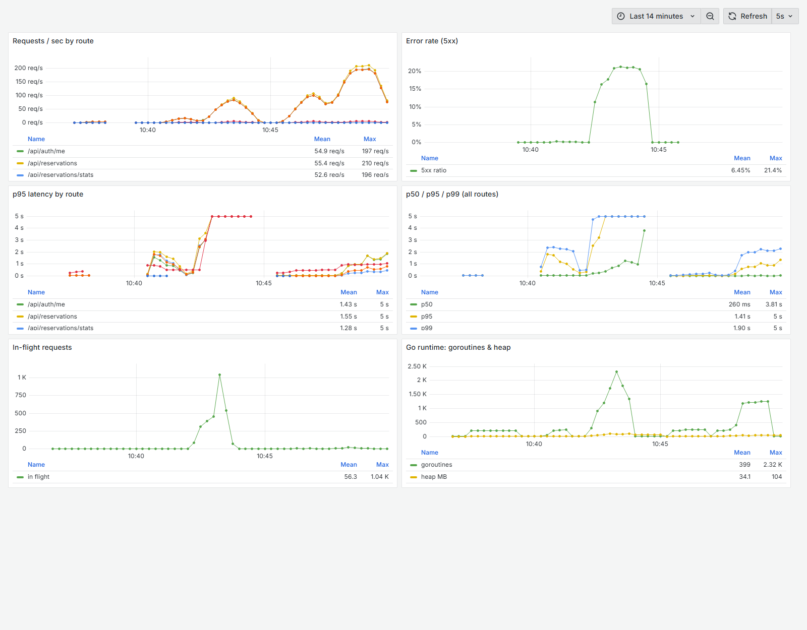
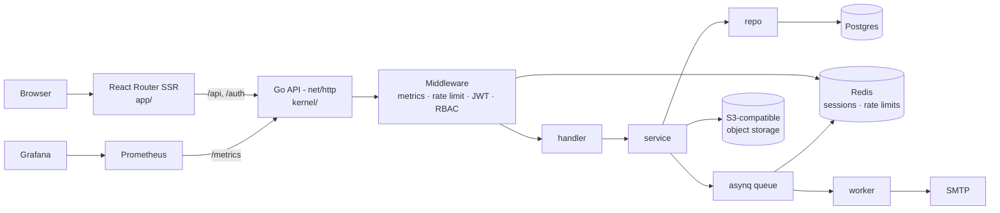

# LabFlow

An open-source **Laboratory Information Management System (LIMS)**. Customers
submit test requests, lab staff move each request through a role-guarded
lifecycle, and finished work is issued as a certificate.

**Go** API (`net/http`, GORM, Postgres, Redis, asynq) · **React Router 7** SSR
frontend · **Prometheus + Grafana** observability · **k6** load tests ·
**Playwright** e2e tests · Docker Compose · GitHub Actions CI.



> I built LabFlow to answer one question about a lab system I'd shipped in
> Node.js: *what does the same domain look like in Go, and how far does it
> scale?* The [performance section](#performance) is the answer, including the
> part where it fell over.

## Contents

- [Features](#features)
- [Architecture](#architecture)
- [Performance](#performance)
- [Testing](#testing)
- [Running locally](#running-locally)
- [Configuration](#configuration)
- [Deployment](#deployment)
- [Design decisions](#design-decisions)
- [Roadmap](#roadmap)

## Features

- **Test requests (reservations).** A customer submits a sample with one or
  more test lines from a versioned catalog (microbiology, chemical, physical).
- **Status lifecycle.** A request moves `pending → sample_received →
  test_on_progress → test_completed → coa_submitted → head_approved →
  order_completed`, and can be `rejected` from any non-terminal state. The
  allowed transitions are defined in one place ([`kernel/lifecycle`](kernel/lifecycle/lifecycle.go)),
  and marking a sample received requires a photo.
- **Role-based access control.** 9 roles (customer, admin, QA, micro/chem
  analysts, micro/chem QC, lab head, MR) and 28 permissions. Every
  protected route declares the permission it needs.
- **Auth.** JWT in an HttpOnly cookie, with the token also kept in Redis so
  logout revokes it server-side. Email OTP verification, password reset,
  bcrypt hashing, Cloudflare Turnstile on login, and Redis-backed rate limiting.
- **Certificates and files** stored in any S3-compatible store (Cloudflare R2,
  MinIO, SeaweedFS).
- **Background email** via an asynq queue on Redis, so SMTP latency never sits
  on the request path.

## Architecture



The backend is layered `handler → service → repo`. Handlers speak HTTP/DTOs,
services hold business rules and depend on small interfaces, and repos are the
only code that touches GORM. Services are unit-tested with fakes, without a
database.

```
kernel/        Go backend
  httpx/       JSON responses, middleware chaining, client IP, request user
  handler/     HTTP handlers (net/http)
  service/     business logic
  repo/        persistence (GORM)
  middleware/  metrics, rate limiting, JWT, RBAC
  lifecycle/   reservation state machine
  worker/      background jobs (asynq)
app/           React Router 7 SSR frontend (+ e2e/ Playwright tests)
loadtest/      k6 scenarios and recorded results
deployments/   dev, prod and loadtest Compose stacks (+ Grafana dashboard)
```

## Performance

I load tested the API with [k6](loadtest/k6/lifecycle.js), using three
scenarios that run at the same time and reflect how a lab actually uses it:

| Scenario | What it does | Share of traffic |
| --- | --- | --- |
| `browse` | customers and staff load the dashboard: `me`, reservation list, stats, test catalog | ~85% |
| `submit` | customers create test requests with two test lines | ~10% |
| `login`  | sign-ins (bcrypt cost 12, so CPU-heavy on purpose) | ~5/s |

Service-level objectives (k6 thresholds): browse p95 < 100 ms, submit p95 <
250 ms, login p95 < 800 ms, errors < 1%.

### It fell over first

The first run at 100 browse iterations/s (≈400 requests/s offered) failed
badly:

| | Baseline | After fix | Change |
| --- | ---: | ---: | ---: |
| Browse p95 | 8,454 ms | **13.5 ms** | 626× faster |
| Browse p99 | 16,616 ms | **38 ms** | |
| Submit p95 | 9,650 ms | **66 ms** | 146× faster |
| Login p95 | 9,334 ms | **347 ms** | |
| Failed requests | **79.5%** | **0.00%** | |
| Postgres `too many clients` errors | 2,794 | 0 | |

*Recorded runs: [`baseline.json`](loadtest/results/baseline.json),
[`after-pool-and-cache.json`](loadtest/results/after-pool-and-cache.json).*

Three separate problems stacked up:

1. **Unbounded connection pool.** `database/sql` allows unlimited open
   connections by default. Under load, every in-flight request opened its own
   connection until Postgres hit `max_connections` and started refusing. In
   the Grafana screenshot that's the in-flight spike to ~1,000 and 2.3k
   goroutines. **Fix:** cap the pool (`DB_MAX_OPEN_CONNS`, default 25) so
   requests queue briefly in Go instead of failing in Postgres.
2. **A permission check on every request cost 3 queries.** The RBAC middleware
   re-loaded the user with `Preload("Roles.Accesses")` on every protected
   call. **Fix:** cache each user's permission set in memory for 30 s
   ([`service/access.go`](kernel/service/access.go)). Roles only change
   through admin/seed operations, so a 30 s delay before a change applies is
   an acceptable trade.
3. **Errors disguised as 403s.** When the database refused a connection, the
   RBAC check returned "no access", so users got **403 Permission denied**
   for requests they were entitled to make. That hides an outage behind
   what looks like a client error. **Fix:** `HasAccess` now returns
   `(bool, error)`, and an error becomes **503**, so it shows up on the 5xx
   dashboard and in alerts.

### Headroom

Doubling the load to 200 iterations/s (**680 requests/s**, 88k requests in
2 minutes) still produced **zero failed requests**, but latency rose past the
SLO (browse p95 671 ms). Every route slowed down together, including trivial
ones like `/api/auth/me`. That points to shared capacity rather than one slow
query: requests queue for the 25-connection pool while bcrypt logins compete
for CPU. ([`after-200rps.json`](loadtest/results/after-200rps.json))

Test machine: a single laptop (Intel i3-1220P, 8 GB RAM) running the API, k6,
Postgres, Redis and Prometheus all at once, so treat these numbers as a floor.

### Reproduce it

```bash
docker compose -f deployments/loadtest/docker-compose.yml --profile app up -d --build
docker compose -f deployments/loadtest/docker-compose.yml --profile app run --rm backend seed
k6 run loadtest/k6/lifecycle.js              # RATE=200 DURATION=2m to push harder
open http://localhost:3001                   # Grafana dashboard "LabFlow API"
```

Without the `app` profile the stack starts only the infrastructure, and you
can run the API on the host (`go run .`) against the same ports. Prometheus
scrapes both.

## Testing

| Layer | Tool | Where | Count |
| --- | --- | --- | --- |
| Unit | `go test` | `kernel/**/_test.go` | 77 tests: services with fakes, lifecycle rules, middleware (RBAC, rate limit, metrics), config |
| End-to-end | Playwright | `app/e2e/` | 9 tests: landing page and quotation, auth redirect, login, RBAC on the API, logout revocation, reservation lifecycle across two roles |
| Load | k6 | `loadtest/k6/` | 3 scenarios with SLO thresholds |

CI ([`ci.yml`](.github/workflows/ci.yml)) runs on every PR: `go vet`, build,
unit tests, frontend typecheck and build, then starts the full stack in Docker
for **Playwright** and a **k6 smoke run whose thresholds must pass**. A
latency regression fails the build just like a broken test.

## Running locally

```bash
# infrastructure: Postgres, Redis, S3 (SeaweedFS), Mailpit, Prometheus, Grafana
docker compose -f deployments/loadtest/docker-compose.yml up -d

# backend
cd kernel
go test ./...
go run . seed      # roles, permissions, test catalog, one user per role, password: password123
go run .           # API on :8080, metrics on /metrics

# frontend
cd app
npm install
npm run dev        # http://localhost:5173, proxies /api and /auth to BACKEND_URL (default :8080)
npm run test:e2e   # Playwright, against the running backend
```

## Configuration

| Variable | Purpose |
| --- | --- |
| `DATABASE_URL`, `MIGRATIONS_URL` | Postgres connection strings |
| `DB_MAX_OPEN_CONNS`, `DB_MAX_IDLE_CONNS` | connection pool size (default 25) |
| `REDIS_URL` | sessions, rate limits, job queue |
| `JWT_SECRET`, `COOKIE_SECRET` | signing keys |
| `S3_ENDPOINT` *or* `MINIO_ENDPOINT` *or* `ACCOUNT_ID` | object storage: any S3 endpoint, MinIO/SeaweedFS, or Cloudflare R2 |
| `MINIO_ACCESS`/`MINIO_SECRET` or `ACCESS_KEY_ID`/`SECRET_ACCESS_KEY` | object storage credentials |
| `SMTP_HOST`, `SMTP_PORT`, `SMTP_USER`, `SMTP_PASS` | outgoing email |
| `QUOTATION_INBOX` | where quotation requests are emailed |
| `TURNSTILE_SECRET` | Cloudflare Turnstile (login bot protection) |
| `BYPASS_TURNSTILE`, `DISABLE_RATE_LIMIT` | test-only switches, refused when `ENV=production` |

A complete production example is in
[`deployments/prod/.env.example`](deployments/prod/.env.example).

## Deployment

Production runs as a Docker Compose stack on a VPS. You provide the reverse
proxy and TLS (see [`deployments/prod/README.md`](deployments/prod/README.md)).

- **CI** (`ci.yml`): unit, e2e and load-smoke tests on every PR.
- **Build** (`build.yml`): multi-stage images pushed to GHCR on `main` and on
  tags. `backend-v*` and `frontend-v*` tags version the two images independently.
- **Deploy** (`deploy.yml`): manual. Pick image tags, and the workflow backs up
  Postgres, pulls, and redeploys with health checks.

## Design decisions

- **Go for the API.** One small static binary and cheap goroutines for
  I/O-bound request handling. The heap averaged about 34 MB during the load
  tests.
- **Layered handler → service → repo with interfaces.** Business rules can be
  tested without a database, and the DB layer can change without touching
  them.
- **State machine as data.** Lifecycle transitions are a map, not scattered
  `if`s, so the frontend reads the same rules from `/api/lifecycle/transitions`.
- **JWT + Redis instead of pure stateless JWT.** It costs one Redis lookup per
  request, which buys real logout and revocation.
- **Background email queue.** A slow SMTP server can't slow down a signup.
- **Metrics labelled by route template** (`/api/reservations/{xid}`, not the
  raw path), so Prometheus label cardinality stays bounded.

## Roadmap

- Cache the permission set in Redis so multiple API replicas share it, and
  invalidate on role changes.
- Index `reservations(status)` and cache `/stats` for large datasets.
- Profile under the 200/s load with `pprof` to split pool-wait time from
  bcrypt CPU time.
- OpenTelemetry tracing across API → Postgres → worker.

## License

MIT
